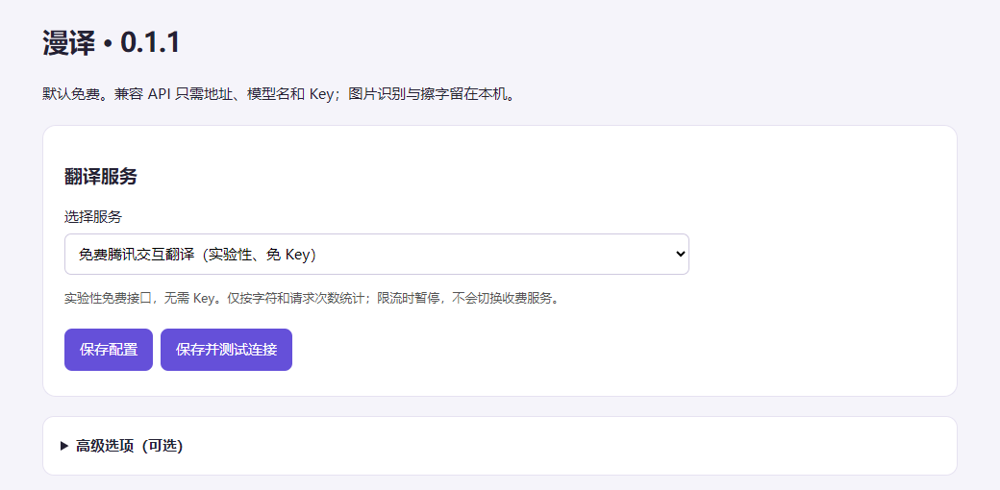
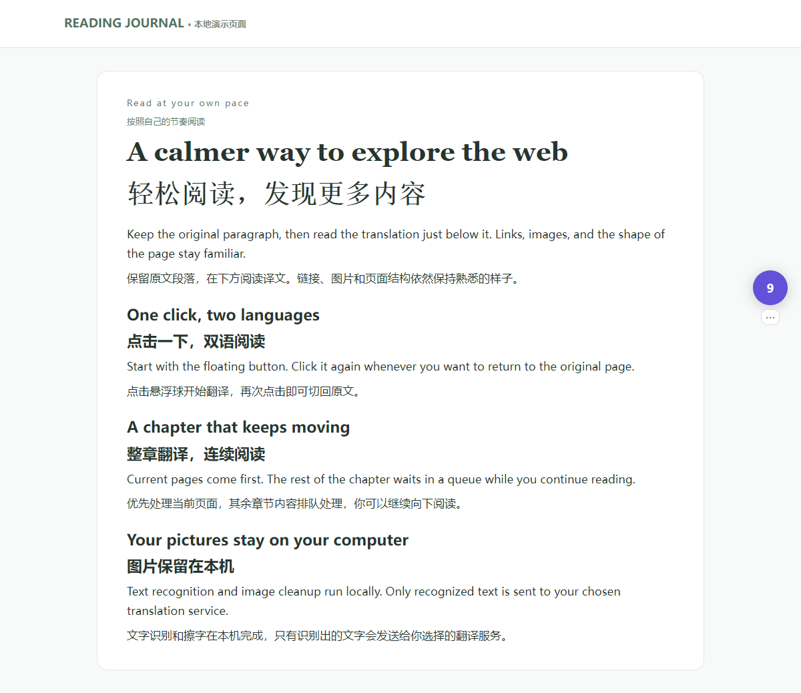
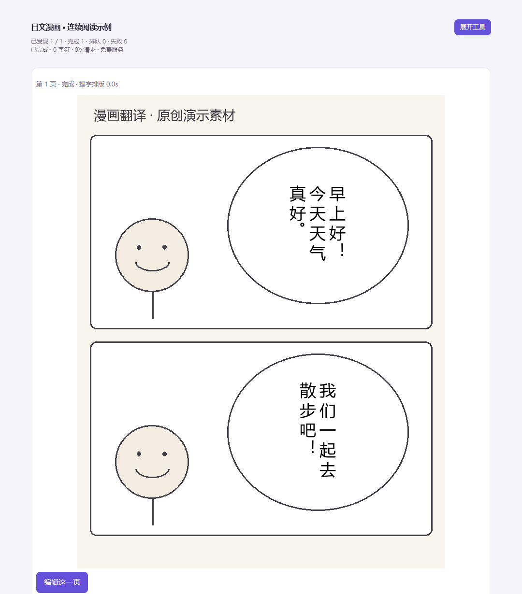

# 漫译 · Manga Web Translator

一键翻译网页、漫画和图片。支持 Chrome，适用于 Windows 10/11 x64。

默认使用免费腾讯，也可选择免费 Bing，或填写自己的 DeepSeek / OpenAI 兼容 API。漫画识别、擦字和排版在本机完成。

## 安装

1. 从 [Releases](https://github.com/Makashibata02/manga-web-translator/releases/latest) 下载 `mwt-setup-0.1.1.exe`、`engine.zip`、`release.json` 和 `chrome-extension-0.1.1.zip`，放在同一文件夹。
2. 运行安装器。完整引擎约 1.6 GiB，建议预留 10 GiB 空间；无需自行安装 Python。已有引擎升级时用 `runtime-update.zip` 代替 `engine.zip`。
3. 解压 Chrome 扩展包，打开 `chrome://extensions`，开启**开发者模式 → 加载已解压的扩展程序**，选择包含 `manifest.json` 的文件夹。请保留该文件夹。

仓库目前为 private，下载需要登录有访问权限的 GitHub 账号。**Code → Download ZIP** 是源码，安装请选择 Releases 中的包。

## 开始使用

1. 打开漫译设置，选择免费服务，点击**保存并测试连接**，按提示允许网页访问。
2. 刷新网页，点击侧边的 **「译」**。再次点击切回原文或原图；「⋯」中可切换服务。
3. 使用自己的模型时，只需填写 **API 地址、模型名、Key**。可以命名保存、另存或删除配置，无需填写价格。

- **网页**：按段落显示双语，随滚动和动态内容继续翻译；arXiv 摘要页提供双语全文入口。
- **漫画**：自动识别阅读区，整章排队、连续阅读，中文默认竖排、列从右到左。任务页可修改译文、重排和导出。
- **扫描本章**：仅在需要提前加载未出现的页时使用；连续阅读查看同一任务，不会再翻译一遍。
- **图片和圈选**：在设置中选择本地图片，或通过「更多工具」圈选网页区域。

查看网页双语和漫画阅读截图

截图使用本地演示页面和原创素材，用于展示界面，不代表特定模型的翻译质量。

## 说明

免费接口为实验性服务，可能限流；不会自动切换到收费模型。API 任务默认累计上限为 100 万 tokens、1000 次请求；有已知单价时另有 5 元估算保护，达到后需主动追加。暂停、刷新不清零，费用以服务账单为准。

图片留在本机，外部翻译服务只接收文字和必要上下文；Key 保存在 Windows 凭据管理器。OCR、艺术字和复杂背景仍可能出错，站点支持范围见[兼容性说明](docs/COMPATIBILITY.md)。

[详细使用说明](docs/MANUAL.md) · [开发与构建](docs/DEVELOPMENT.md) · [第三方组件](THIRD_PARTY.md)

许可证：[GPL-3.0](LICENSE)。
