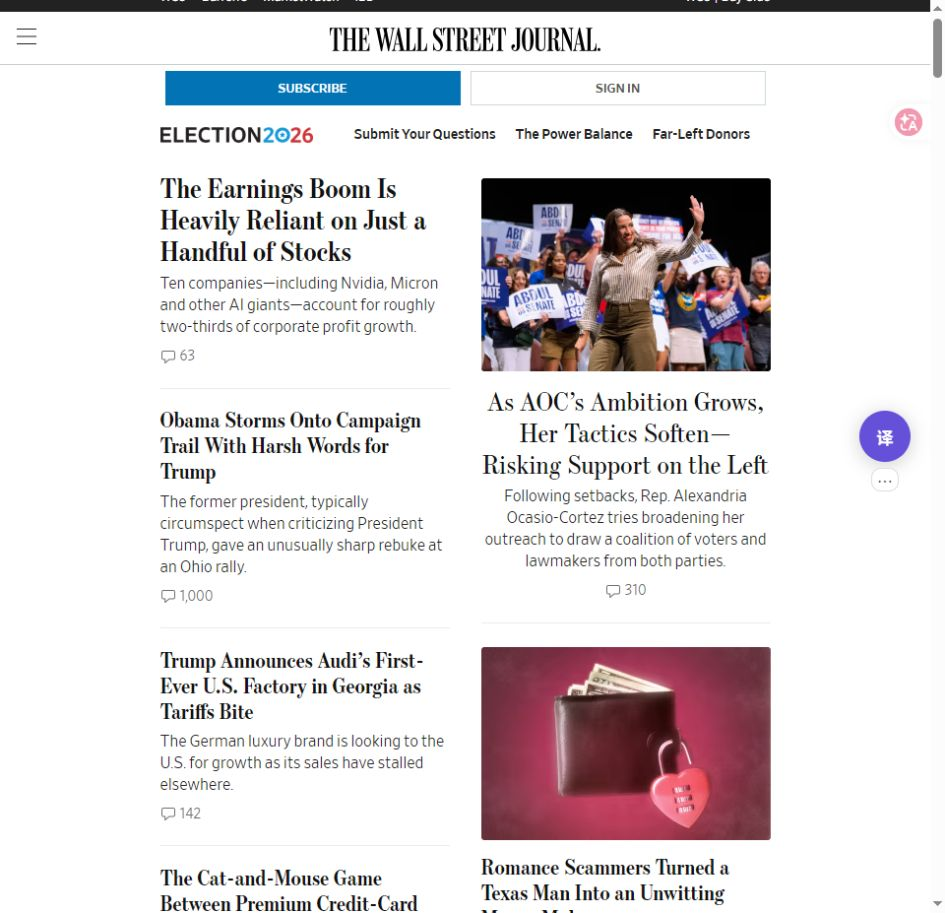
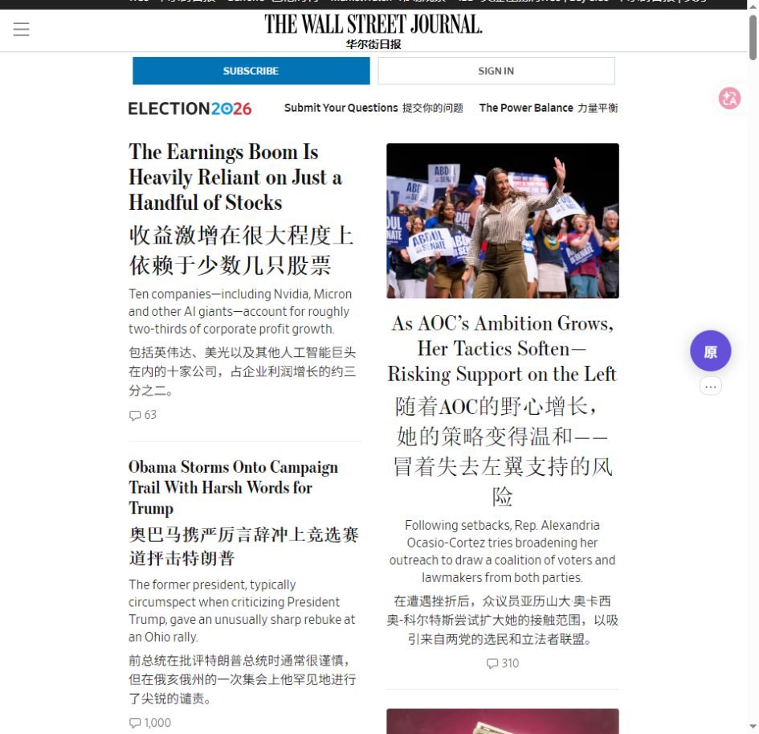
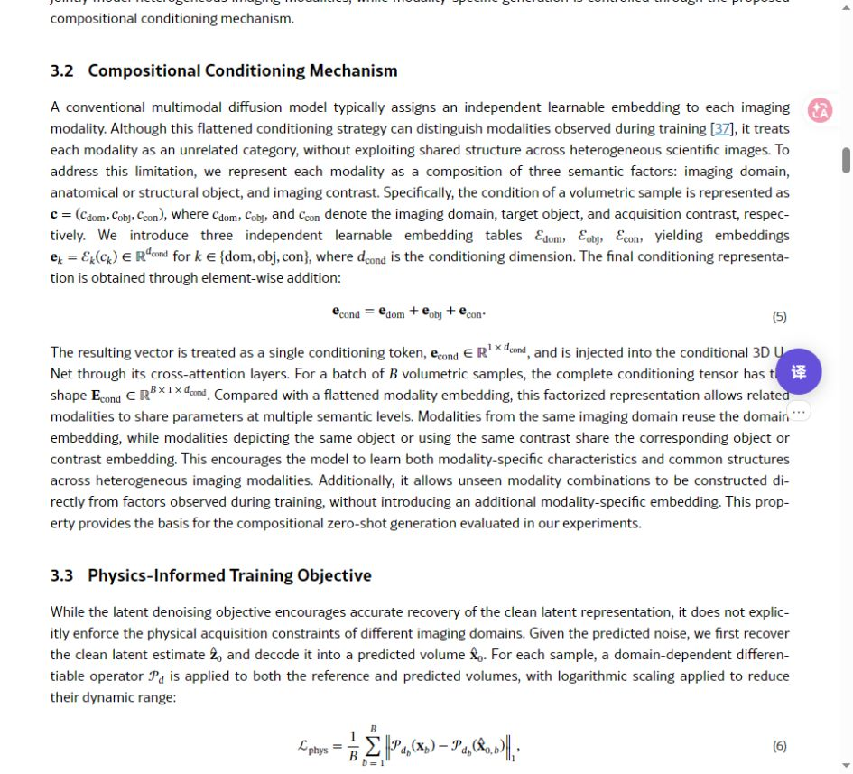
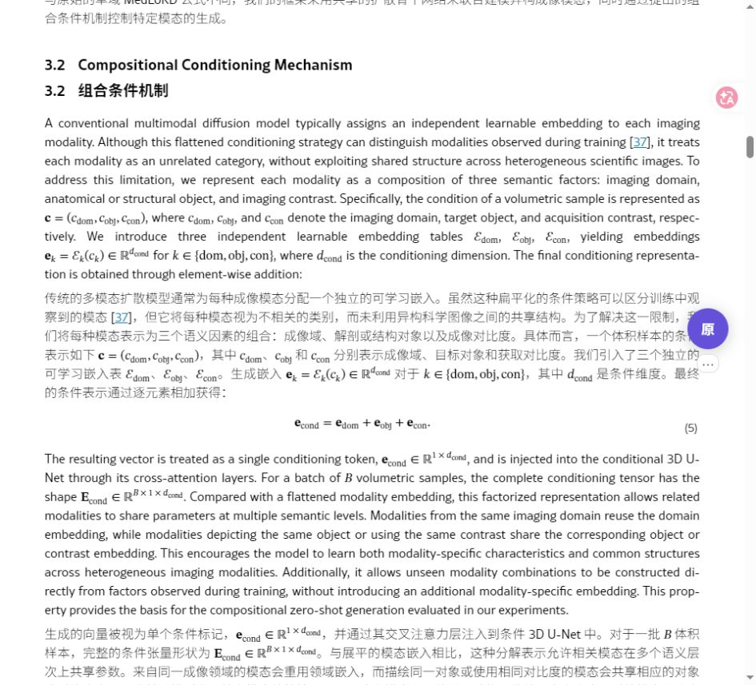
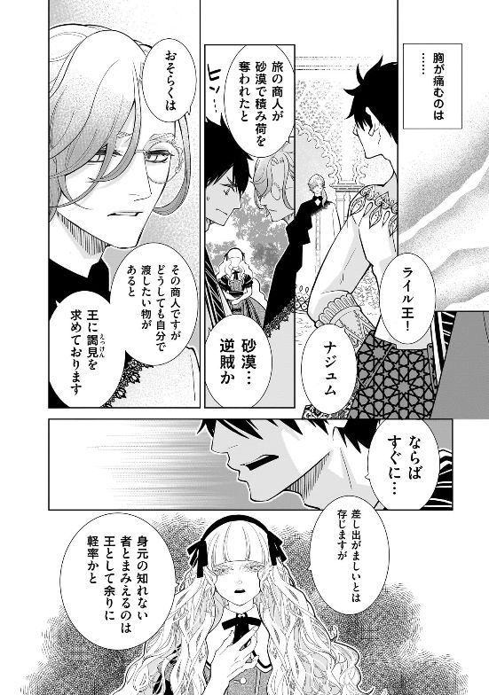
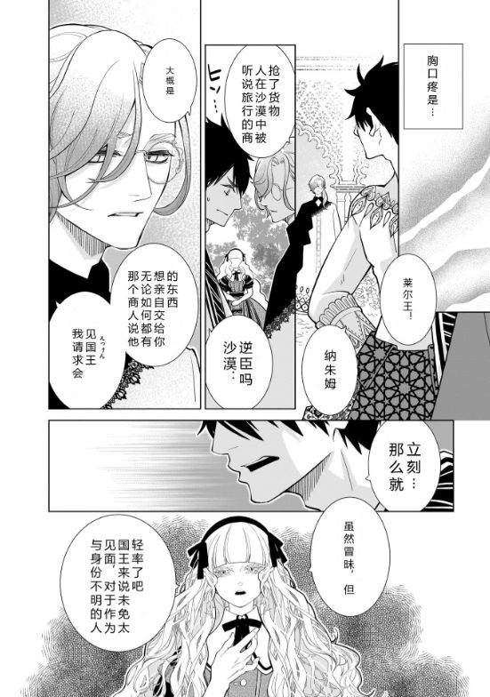

# 漫译

Chrome 网页、漫画和图片翻译插件，目前支持 Windows 10/11 x64。

点网页右侧的「译」开始翻译，再点一次切回原文或原图。默认用免费腾讯，也可以选免费 Bing，或接入自己的 DeepSeek / OpenAI 兼容接口。

## 翻译效果

下面是实际页面的翻译前后对比。网页和论文使用免费 Bing，漫画取自已有翻译任务。点击图片可放大。

### WSJ 网页

标题和摘要下方显示中文，保留原文、图片和链接。[原页面](https://www.wsj.com/)

| 翻译前 | 翻译后 |
| --- | --- |
|  |  |

### arXiv 论文

正文按段落对照，公式和引用保留。[原论文](https://arxiv.org/html/2610.30313v1)

| 翻译前 | 翻译后 |
| --- | --- |
|  |  |

### 日文漫画

《忌王の花嫁》第11话（松本花／コミックトレイル），同一页原图与译图对照。中文默认竖排，列从右往左。[原章节](https://comic-trail.com/episode/12207421984055325331)

| 翻译前 | 翻译后 |
| --- | --- |
|  |  |

## 安装

1. 到 [Releases](https://github.com/Makashibata02/manga-web-translator/releases/latest) 下载 `mwt-setup-0.1.1.exe`、`engine.zip`、`release.json`、`chrome-extension-0.1.1.zip`，放在同一个文件夹。
2. 运行安装器。完整引擎约 1.57 GiB，建议预留 10 GiB 空间，不用自行安装 Python。已经装过引擎的用户，用 `runtime-update.zip` 代替 `engine.zip` 升级。
3. 解压 Chrome 扩展包，打开 `chrome://extensions`，开启「开发者模式」，点击「加载已解压的扩展程序」，选择包含 `manifest.json` 的文件夹。以后不要删除这个文件夹。
4. 打开漫译设置，选择服务，点击「保存并测试连接」。刷新要翻译的网页。

请从 Releases 下载安装包；「Code → Download ZIP」下载的是源码。

## 怎么用

- **网页**：点「译」开始，滚动或展开新内容后会继续翻译。「⋯」菜单可以切换服务。
- **arXiv**：摘要页点击「双语版本（漫译）」打开双语 HTML 全文；没有 HTML 全文时只能翻译摘要，不生成 PDF。
- **漫画**：打开漫画章节，点「译」，本章图片进入队列。当前页优先，完成一页显示一页；分页站可在连续阅读页查看。
- **扫描本章**：提前加载还没出现的图片。「连续阅读 / 任务」查看的是同一批结果，不会重新翻译一遍。
- **图片、圈选**：本地图片从设置中选择；网页圈选在「更多工具」里。

接入自己的模型只需 API 地址、模型名和 Key，不必填价格。配置可以命名保存、另存和删除。

## 使用前了解

免费接口可能限流，失败时不会自动换成收费模型。漫画的艺术字、拟声词和复杂背景仍可能识别不准，译文可以手动修改、重新排版。

识别、擦字和排版在本机完成；文字和必要上下文会发给所选翻译服务，Key 存在 Windows 凭据管理器中。API 任务按累计用量限额，达到上限后暂停，需手动追加；刷新和恢复不清零。

[详细说明](docs/MANUAL.md) · [站点支持范围](docs/COMPATIBILITY.md) · [开发文档](docs/DEVELOPMENT.md) · [第三方组件](THIRD_PARTY.md)

许可证：[GPL-3.0](LICENSE)。
